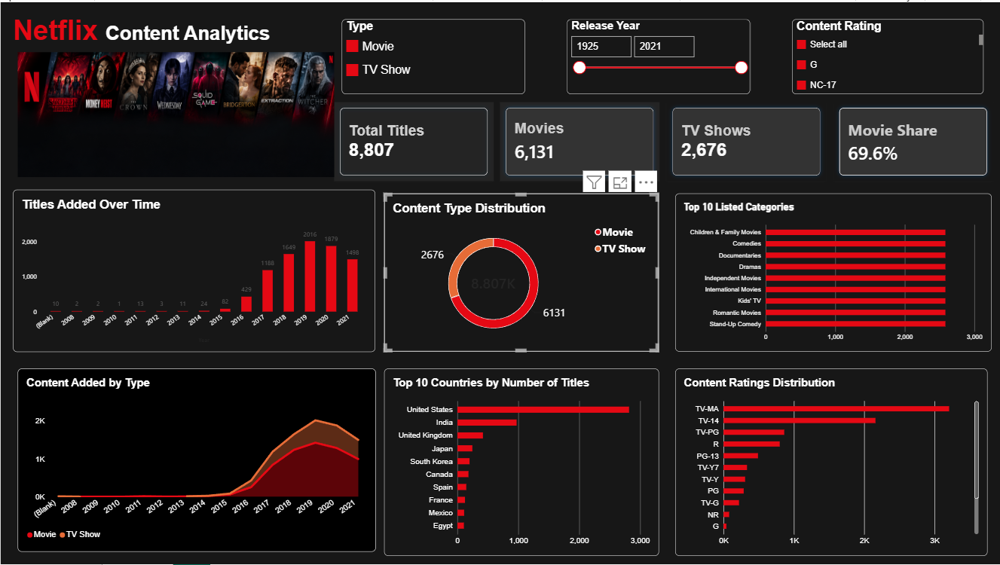

# Netflix Content Analytics

An end-to-end data analytics project using Python, Pandas, NumPy, Jupyter Notebook, and Power BI to analyze Netflix catalog composition, country representation, content ratings, listed categories, and yearly additions.

## Dashboard Preview



The interactive Power BI dashboard presents key catalog metrics, yearly additions, content type distribution, top listed categories, country representation, and content rating distribution through charts and interactive filters.

### Key Metrics

| Metric | Value |
|---|---:|
| Total Titles | 8,807 |
| Movies | 6,131 |
| TV Shows | 2,676 |
| Movie Share | 69.6% |

## Project Overview

This project analyzes the Netflix Movies and TV Shows dataset containing 8,807 titles and 12 columns. Python is used for data cleaning, validation, and exploratory data analysis (EDA), while Power BI presents the findings through an interactive dashboard.

The project follows a structured analytics workflow, from raw data preparation to analytical summaries and dashboard development, with an emphasis on data quality, reusable Python functions, and clear reporting.

## Project Structure

```text
Netflix_Content_Analytics/
├── data/
│   ├── processed/
│   │   └── netflix_cleaned.csv
│   └── raw/
│       └── netflix_titles.csv
├── images/
│   └── netflix_dashboard.png
├── notebooks/
│   ├── 01_data_understanding.ipynb
│   ├── 02_data_cleaning.ipynb
│   └── 03_eda.ipynb
├── powerbi/
│   ├── Netflix_Content_Analytics.pbix
│   └── Netflix_Content_Analytics_Dashboard.docx
├── src/
│   ├── __init__.py
│   ├── analysis.py
│   ├── data_cleaning.py
│   └── main.py
├── .gitignore
├── README.md
└── requirements.txt
```

### Directory and File Description

- **`data/raw/`** — contains the original Netflix dataset.
- **`data/processed/`** — stores the cleaned dataset generated by the Python workflow.
- **`images/`** — contains the dashboard screenshot displayed in this README.
- **`notebooks/`** — contains notebooks for data understanding, cleaning, and exploratory analysis.
- **`powerbi/`** — contains the interactive Power BI dashboard and its Word documentation.
- **`src/data_cleaning.py`** — handles data loading, cleaning, validation, and saving.
- **`src/analysis.py`** — calculates KPIs and analytical summaries.
- **`src/main.py`** — coordinates the complete cleaning and analysis workflow.
- **`src/__init__.py`** — marks `src` as a Python package.
- **`.gitignore`** — excludes virtual environments, caches, and unnecessary local files from Git.
- **`requirements.txt`** — lists the Python libraries needed by the scripts.
- **`README.md`** — documents the project, workflow, findings, and setup instructions.

## Problem Statement

Raw catalog data contains valuable information, but meaningful analysis requires consistent data preparation and structured reporting.

Missing values, incorrect duration entries, inconsistent text formatting, and date conversion issues can affect the reliability of analytical results. Information spread across multiple columns can also make it difficult to compare content types, ratings, countries, categories, and yearly catalog additions.

This project addresses the following analytical questions:

- What is the distribution of Movies and TV Shows?
- How did catalog additions vary by year?
- Which countries are most represented in the dataset?
- Which content ratings occur most frequently?
- Which listed categories have the highest title counts?
- What data quality issues need to be corrected or validated before analysis?

## Proposed Solution

The project implements an end-to-end analytics workflow using Python and Power BI.

- **Data Cleaning:** Handled missing values, corrected identified duration values, converted date fields, and normalized text formatting.
- **Data Quality Validation:** Checked dataset dimensions, duplicate records, duplicate show IDs, duration formats, and remaining line breaks.
- **Exploratory Data Analysis:** Analyzed content types, yearly additions, country representation, ratings, and listed categories.
- **KPI Analysis:** Calculated total titles, Movies, TV Shows, and Movie share.
- **Interactive Dashboard:** Developed a Power BI dashboard with KPI cards, charts, and interactive filters.
- **Reusable Python Modules:** Organized cleaning, analysis, and execution into separate Python files.

## Technologies Used

| Technology | Purpose |
|---|---|
| Python | Data cleaning, validation, and analysis |
| Pandas | Data manipulation, missing-value handling, and aggregation |
| NumPy | Handling missing values during data correction |
| Matplotlib | Data visualization during exploration |
| Seaborn | Statistical data visualization and EDA |
| Jupyter Notebook | Interactive data exploration and experimentation |
| Power BI Desktop | Interactive dashboard creation and reporting |
| PyCharm | Python development and project organization |
| Git | Version control |
| GitHub | Source code hosting and portfolio presentation |
| Markdown | Project documentation in README.md |

## Project Workflow

1. **Data Understanding:** Inspected the dataset structure, columns, and data types.
2. **Data Cleaning:** Handled missing values, corrected identified duration anomalies, converted date fields, and normalized text.
3. **Data Quality Validation:** Checked duplicate rows, duplicate IDs, duration formats, and remaining line breaks.
4. **Exploratory Data Analysis:** Calculated summaries for content types, yearly additions, countries, ratings, and categories.
5. **KPI Development:** Calculated catalog totals and the percentage of titles classified as Movies.
6. **Dashboard Development:** Created a Power BI dashboard with KPI cards, charts, and interactive filters.
7. **Code Refactoring:** Organized the Python workflow into reusable modules with a single main entry point.

## Key Findings

Based on the cleaned dataset:

- **Total titles:** 8,807
- **Movies:** 6,131
- **TV Shows:** 2,676
- **Movie share:** 69.6%
- **TV Show share:** 30.4%
- **Most represented country:** United States, with 3,689 title-country associations
- **Most frequent listed category:** International Movies, with 2,752 title-category associations
- **Most frequent content rating:** TV-MA, with 3,207 titles

The yearly additions analysis shows that 2019 had the highest count in the dataset, with 2,016 titles.

Country and category counts can overlap because a title may be associated with multiple countries or listed categories. Yearly additions are based on the `date_added` field, not the original release year.

## Data Quality Challenges and Solutions

### 1. Incorrect Duration Values

**Challenge:** Three identified records contained duration values that required correction.

**Solution:** Corrected the duration values for show IDs `s5542`, `s5795`, and `s5814` to `74 min`, `84 min`, and `66 min`, respectively. Their rating values were set to missing before the missing-value handling step.

### 2. Missing Values

**Challenge:** Fields such as director, cast, country, and rating contained missing values.

**Solution:** Replaced missing values in these fields with `Unknown` to represent missing information consistently in the cleaned dataset.

### 3. Date Conversion Issues

**Challenge:** The `date_added` column needed to be converted to datetime format for yearly analysis. Using Pandas' `.dt` accessor on a non-datetime column caused an error during development.

**Solution:** Used `pandas.to_datetime()` with an explicit date format and `errors="coerce"`. The analysis module loads the cleaned date column as datetime data before extracting years.

### 4. Text Formatting and Line Breaks

**Challenge:** Some text fields contained carriage returns or newline characters that could interfere with clean tabular output and downstream reporting.

**Solution:** Used Pandas string operations to replace line breaks with spaces and remove surrounding whitespace. Added a separate validation function to count remaining line breaks.

### 5. Data Quality Validation

**Challenge:** Cleaning data alone does not guarantee that the resulting dataset follows the expected structure.

**Solution:** Implemented validation checks for dataset dimensions, duplicate rows, duplicate show IDs, and invalid Movie and TV Show duration formats. The validation function raises a `ValueError` when these critical checks fail.

### 6. Date Analysis Error

**Challenge:** The yearly additions analysis initially encountered an error when extracting years from a column that was not recognized as datetime data.

**Solution:** Configured the analysis module to parse `date_added` as a datetime column when loading the cleaned CSV, enabling the `.dt.year` operation to work correctly.

### 7. Code Organization

**Challenge:** Keeping data cleaning, analysis, and execution in one script would make the workflow harder to maintain and reuse.

**Solution:** Separated the code into `data_cleaning.py`, `analysis.py`, and `main.py`. The main script coordinates the workflow through a single entry point.

## Data Quality Results

The final validation run reported:

- Dataset dimensions: **8,807 rows × 12 columns**
- Unique show IDs: **8,807**
- Duplicate rows: **0**
- Duplicate show IDs: **0**
- Invalid Movie duration formats: **0**
- Invalid TV Show duration formats: **0**
- Remaining line breaks in text fields: **0**

These results confirm that the implemented validation checks passed for the cleaned dataset. They do not establish that every value in the original dataset is factually correct.

## Jupyter Notebooks

The `notebooks/` directory documents the exploratory workflow:

- **`01_data_understanding.ipynb`** — dataset inspection and initial understanding.
- **`02_data_cleaning.ipynb`** — data cleaning experiments and preparation.
- **`03_eda.ipynb`** — exploratory analysis and visualization.

The notebooks document the exploration process, while the `src/` modules provide reusable code for running the main workflow.

## Installation and Setup

### Prerequisites

- Python installed on your system
- Git
- Jupyter Notebook or JupyterLab
- Microsoft Power BI Desktop to open the dashboard

### 1. Clone the Repository

```bash
git clone https://github.com/Kishore292006/netflix-content-analytics.git
cd netflix-content-analytics
```

### 2. Create a Virtual Environment

```bash
python -m venv .venv
```

Activate it on Windows PowerShell:

```powershell
.\.venv\Scripts\Activate.ps1
```

### 3. Install Dependencies

```bash
pip install -r requirements.txt
```

### 4. Prepare the Dataset

Place the raw Netflix dataset at:

```text
data/raw/netflix_titles.csv
```

The Python scripts expect the raw CSV file at this location.

### 5. Run the Project

From the project root, execute:

```bash
python src/main.py
```

The program cleans and validates the raw dataset, saves the processed CSV, and displays the analysis summaries in the terminal.

### 6. Open the Power BI Dashboard

Open `powerbi/Netflix_Content_Analytics.pbix` using Microsoft Power BI Desktop.

The dashboard image in this README is a static preview. The `.pbix` file is required for interactive exploration.

The Word document `powerbi/Netflix_Content_Analytics_Dashboard.docx` contains the dashboard documentation.

## Business Value

This project demonstrates how raw catalog metadata can be cleaned, validated, analyzed, and presented through an interactive dashboard.

The analysis helps users understand catalog composition and compare content types, country representation, ratings, categories, and yearly additions. The reusable Python modules and validation checks also demonstrate practical data preparation and analytical programming skills.

The findings describe catalog metadata, not actual viewer preferences or commercial performance.

## Limitations

- The dataset describes catalog metadata, not actual viewing behavior.
- It does not contain title-level viewership, streaming hours, revenue, subscriber engagement, or profitability.
- Country and category counts can overlap because titles may have multiple associated values.
- Titles with missing `date_added` values are excluded from the yearly additions analysis.
- The findings describe the supplied dataset and should not be interpreted as current Netflix catalog statistics.

## Future Improvements

- Add automated unit tests for data cleaning and validation functions.
- Expand the analysis with additional, well-defined analytical questions.
- Improve automated reporting and documentation.
- Add a reproducible Python environment with documented dependency versions.
- Refine dashboard accessibility, labeling, and analytical storytelling.

## Author

**Kishore Mattapalli**  
B.Tech — Computer Science and Engineering (AI & Machine Learning)  
GD Goenka University

- **GitHub:** [Netflix Content Analytics](https://github.com/Kishore292006/netflix-content-analytics)
- **LinkedIn:** [Kishore Mattapalli](https://www.linkedin.com/in/mattapalli-kishore-74a134410/)

---

*This project was developed as part of my data analytics portfolio to demonstrate practical skills in Python, data cleaning, exploratory data analysis, business metrics, and Power BI dashboard development.*